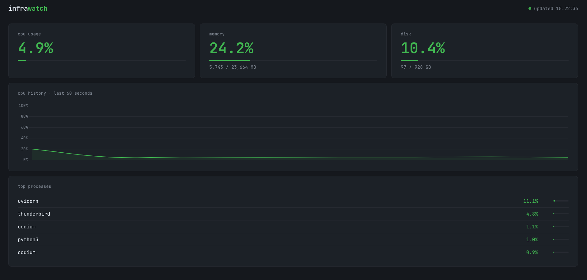

# infrawatch

A lightweight system monitoring dashboard that reads live data from the Linux kernel and displays it in a web UI.

Built to learn how Linux exposes system metrics through `/proc` and how to serve that data via a REST API.



## What it does

- Reads CPU usage from `/proc/stat` using a bash script
- Reads memory usage from `/proc/meminfo`
- Reads disk usage with `df`
- Lists top 5 processes by CPU with `ps`
- Serves all of this through a FastAPI backend
- Shows everything live in a browser dashboard that updates every 5 seconds

## Tech stack

- **Bash** — collectors that read directly from the Linux kernel
- **Python / FastAPI** — REST API that runs the bash scripts and returns JSON
- **Chart.js** — live CPU history chart in the browser
- **Docker** — containerized so it runs anywhere

## How to run

**With Docker (recommended):**
```bash
docker compose up --build
```
Then open `http://localhost:8080`

**Without Docker:**
```bash
python -m venv .venv
source .venv/bin/activate
pip install -r requirements.txt
uvicorn backend.main:app --port 8080
```

## Project structure

```
infrawatch/
├── collectors/        # bash scripts that read /proc
│   ├── cpu.sh
│   ├── memory.sh
│   ├── disk.sh
│   └── processes.sh
├── backend/
│   └── main.py        # FastAPI app
├── frontend/
│   ├── index.html
│   └── app.js
├── Dockerfile
└── docker-compose.yml
```

